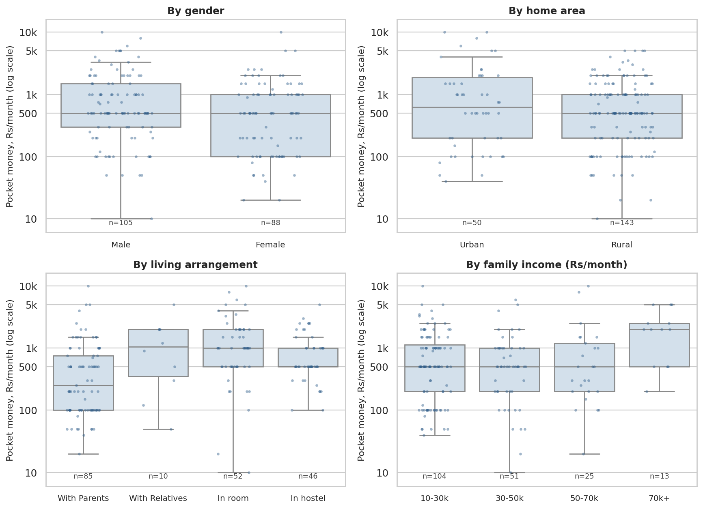
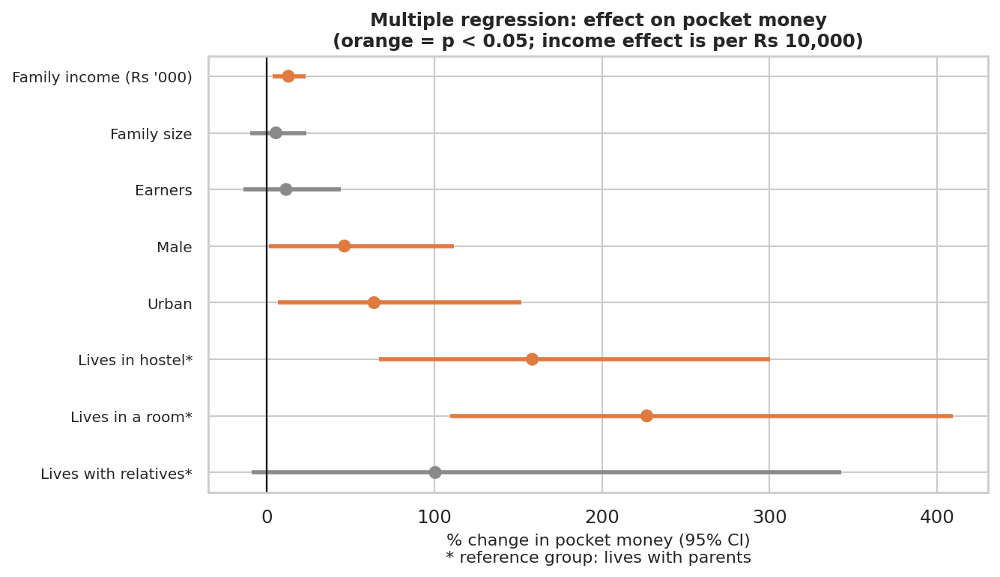

# Pocket Money Expenditure Analysis

A statistical study of how college students **receive, spend, save and invest** their pocket money,
based on a survey of **203 students**. The project covers the full workflow: data cleaning, descriptive statistics,
exploratory visualisation, hypothesis testing (t-test, ANOVA, chi-square), correlation, and simple and multiple linear regression
with diagnostics and a robustness check.

**Full write-up:** [`report/Pocket_Money_Statistical_Report.pdf`](report/Pocket_Money_Statistical_Report.pdf)

> **Data source:** survey collected by **Vaishnavi Deshmukh** (UG classmate) in Aug-Sep 2023 and used here with her permission. The cleaning, analysis and write-up are my own work.
> **Author:** Deepak Nandode, M.Sc. Industrial Engineering & Operations Research, IIT Bombay

---

## Key findings

| # | Finding | Evidence |
|---|---------|----------|
| 1 | The typical student gets **Rs 500 a month** (mean Rs 1,091). Amounts are heavily right-skewed. | n = 193 usable answers; skewness 3.2; analysed on a log scale |
| 2 | **Where a student lives is the strongest factor.** Those in a room or hostel get about 2.6 to 3.3 times the pocket money of those living with parents. | ANOVA F(3, 189) = 9.60, p < 0.001; regression: +158% (hostel), +227% (room); still holds after removing the 13 largest amounts |
| 3 | Family income, gender and home area have **small, fragile effects**. | Significant at 5% in some tests, but not when 13 very large amounts are removed; with 12 tests run, p-values just under 0.05 may be chance |
| 4 | Students with more pocket money **save a smaller share** of it. | Spearman rho = -0.20, p = 0.004 |
| 5 | Investing, needing a fixed monthly amount, personal spending and cash/online mode are **not associated** with gender, home area or living arrangement. | Six chi-square tests, all p > 0.05 |
| 6 | The multiple regression explains **21%** of the variation in log pocket money (adj. R2 = 0.18); family income alone explains 2%. | n = 193; no multicollinearity, no heteroscedasticity, no highly influential points (max Cook's D = 0.10); residuals mildly non-normal (Shapiro p = 0.024), robust (HC3) errors give the same conclusions |





---

## Methods

| Stage | What was done | Script |
|-------|---------------|--------|
| Cleaning | Bilingual headers renamed, duplicate column names resolved, ranges converted to midpoints, banded percentages converted to midpoints, multi-select answers split into flags, e-mails and free text removed | `src/01_clean_data.py` |
| Descriptives | Frequencies, mean / SD / quartiles / skewness, group summaries, Shapiro-Wilk | `src/02_analysis.py` |
| Visualisation | 9 figures (demographics, distributions, boxplots, usage, savings, heatmap, regression plots, diagnostics) | `src/02_analysis.py` |
| Hypothesis tests | 2 Welch t-tests, 3 one-way ANOVAs, 1 Mann-Whitney, 6 chi-square tests; Kruskal-Wallis and Fisher checks | `src/02_analysis.py` |
| Correlation | Spearman matrix with p-values; Pearson on ln(pocket money) | `src/02_analysis.py` |
| Regression | Simple and multiple OLS on ln(pocket money); HC3 robust errors, VIF, Breusch-Pagan, Cook's distance, Q-Q plot; sensitivity analysis without outliers | `src/02_analysis.py`, `src/stats_utils.py` |
| Report | PDF built directly from the results files | `src/03_build_report.py` |

Pocket money is highly skewed, so parametric tests and regression use **ln(pocket money)**, with non-parametric tests as a check.
OLS and its diagnostics are implemented directly with NumPy/SciPy (no statsmodels needed).

### Hypothesis test summary

| ID | Test | p | Significant at 5%? |
|----|------|---|--------------------|
| T1 | Welch t: Male vs Female | 0.036 | Yes |
| T2 | Welch t: Urban vs Rural | 0.329 | No |
| A1 | ANOVA: living arrangement | < 0.001 | **Yes** |
| A2 | ANOVA: family income | 0.014 | Yes |
| A3 | ANOVA: stream | 0.036 | Yes |
| M1 | Mann-Whitney: % saved, away vs with family | 0.670 | No |
| C1-C6 | Chi-square (invests x gender / area / income, same amount monthly x living, personal spending x gender, receiving mode x area) | 0.066 to 0.689 | No |

Full table: [`results/hypothesis_tests_summary.csv`](results/hypothesis_tests_summary.csv)

---

## Project structure

```
pocket-money-analysis/
├── README.md
├── run_all.sh                  # runs the three scripts in order
├── requirements.txt
├── LICENSE
├── data/
│   ├── raw/                    # raw export (not committed: contains e-mails) + README
│   ├── processed/
│   │   ├── pocket_money_clean.csv      # anonymised, analysis-ready
│   │   └── cleaning_log.json           # counts of what the cleaning step changed
│   └── DATA_DICTIONARY.md
├── src/
│   ├── 01_clean_data.py
│   ├── 02_analysis.py
│   ├── 03_build_report.py
│   └── stats_utils.py          # t-test, ANOVA, chi-square, OLS + diagnostics
├── results/                    # every table (CSV) + results.json
├── figures/                    # 9 PNG figures
└── report/
    └── Pocket_Money_Statistical_Report.pdf
```

## How to run

```bash
git clone <your-repo-url>
cd pocket-money-analysis
python -m venv .venv && source .venv/bin/activate     # Windows: .venv\Scripts\activate
pip install -r requirements.txt

python src/02_analysis.py        # uses the processed CSV already in the repo
python src/03_build_report.py    # rebuilds the PDF report
# Optional: to redo cleaning, put the raw .xlsx in data/raw/ and run python src/01_clean_data.py first
```

Developed and tested with Python 3.12, pandas 3.0, NumPy 2.4, SciPy 1.17 (SciPy 1.11 or newer is required).

## Limitations

- Convenience sample from a single institution; results should not be generalised to all students.
- Self-reported data; share spent/saved and family income are banded, and midpoints add measurement error.
- The survey does not state the time period for pocket money; it is treated as monthly. A few very small values (Rs 10 to 50) cannot be verified.
- Small subgroups (living with relatives, arts stream, family income above Rs 70k) limit power.
- Observational data: associations are not causal. Twelve tests were run, so an isolated p-value just under 0.05 may be a chance finding.

## Ethics and privacy

E-mail addresses, exact timestamps and free-text answers were removed before analysis. Department and the parents' occupations were also left out of the published file because they could identify individuals in a small sample, and no analysis uses them. Only the anonymised file is committed.
Some respondents are 17 years old, so keep the raw data private. The data collector gave permission for this analysis; the original survey responses remain hers.
